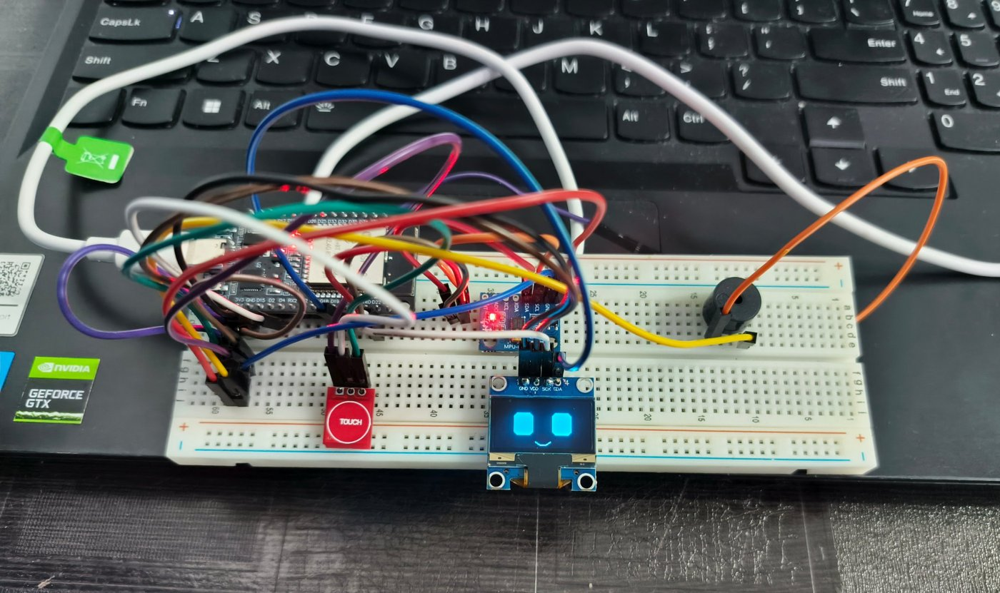
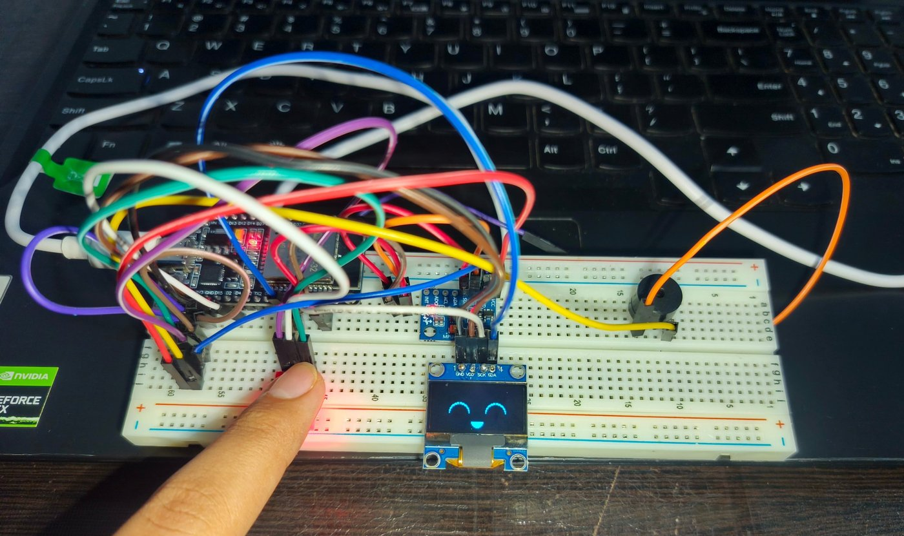
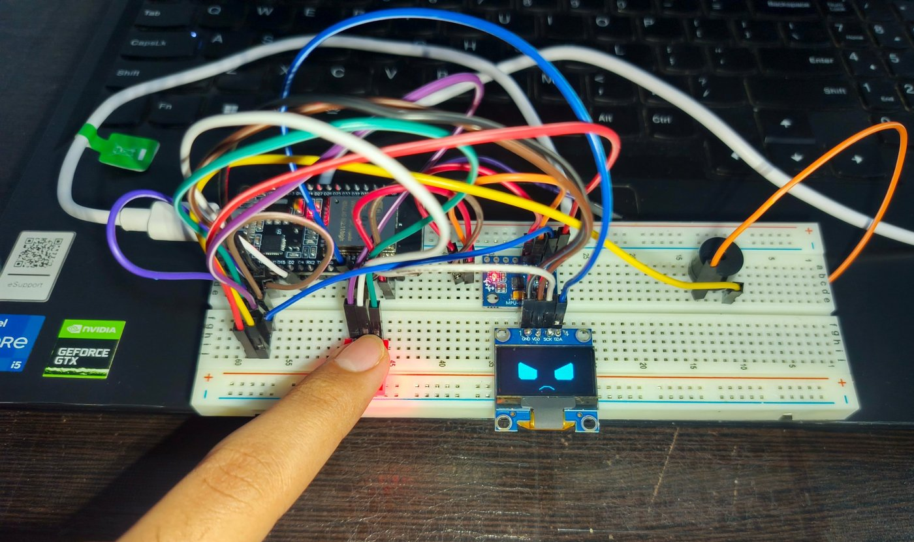
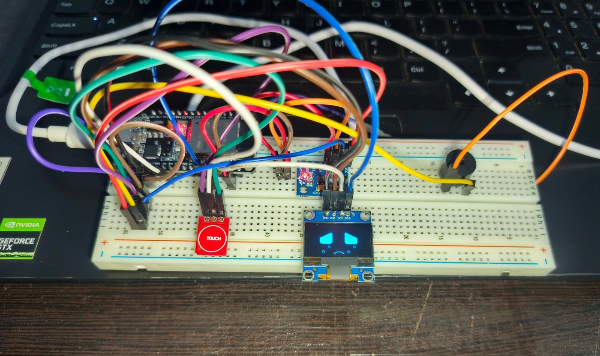
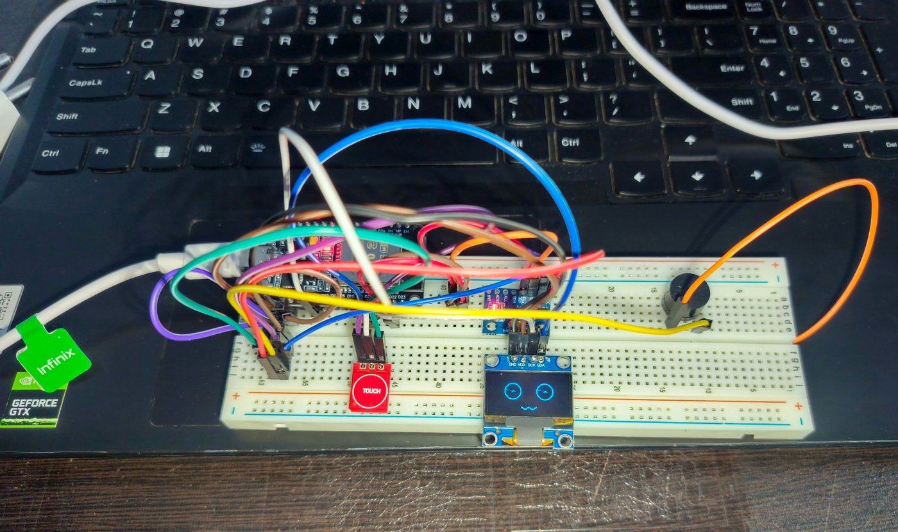
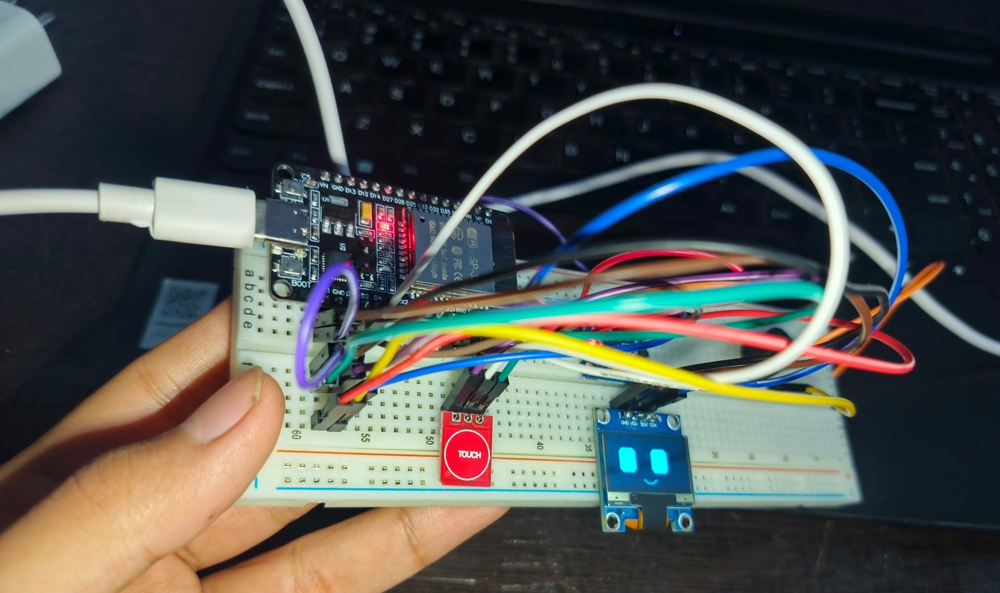
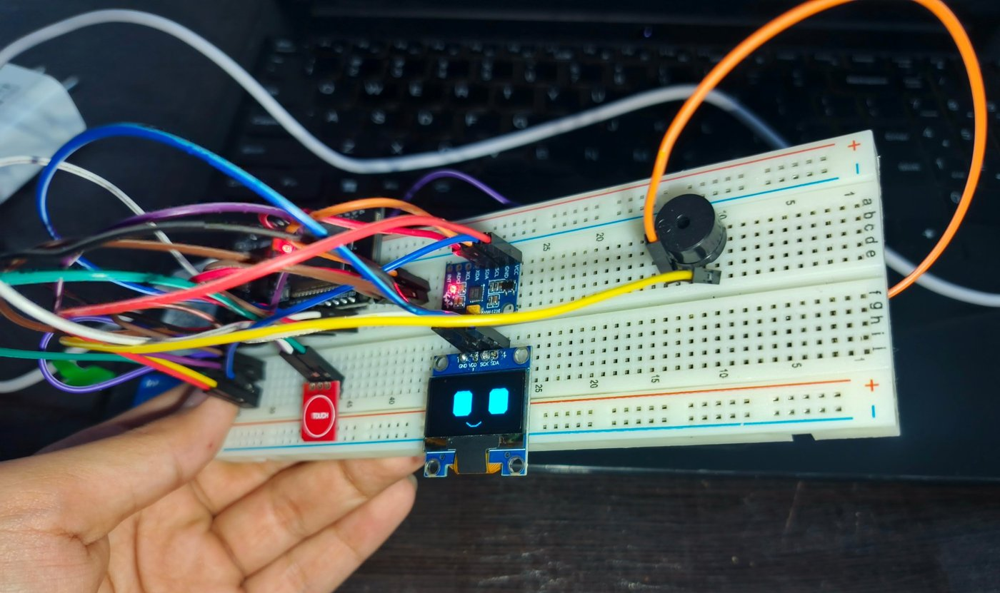
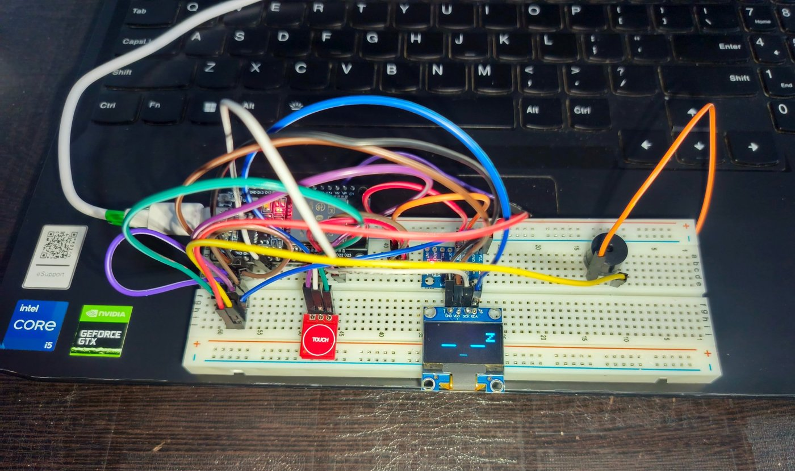

# Mochi Robot (ESP32)

Mochi is a small robot pet with a face on a tiny screen that shows how it feels.

- It reacts when you touch it, shake it or tilt it, and it makes beep sounds
- If nobody plays with it for 30 seconds, it falls asleep, and a touch wakes it up

## Components

- **ESP32 board:** the brain of the robot
- **OLED screen:** shows Mochi's face
- **MPU-6050 motion sensor:** feels shaking and tilting
- **Touch sensor:** feels when Mochi is touched
- **Buzzer:** makes the beep sounds
- **Breadboard, wires and USB cable:** connect and power everything

## How it works

| Action | What Mochi does |
|---|---|
| Touch once | Gets happy, shows a smiling face and a happy beep |
| Keep finger on it for a few seconds | Gets angry and shows angry eyes |
| Touch 4 times quickly | Cries with tears and sad beeps |
| Shake the robot | Gets dizzy and shows spinning eyes |
| Tilt left or right | Eyes look towards that side |
| Leave it alone for 30 seconds | Falls asleep, and a touch wakes it up |

### Touched once

### Pressed for a long time

### Pressed 4 times

### Shaken

### Tilted right

### Tilted left

### Sleeping

## Pin connections

| Part | ESP32 pin |
|---|---|
| OLED and MPU-6050 (SDA) | GPIO 21 |
| OLED and MPU-6050 (SCL) | GPIO 22 |
| Touch sensor | GPIO 4 |
| Buzzer | GPIO 25 |

## How to run

1. Install the Arduino IDE and add ESP32 board support
2. Install the libraries **Adafruit GFX** and **Adafruit SSD1306**
3. Open `mochi_robot.ino`, select **ESP32 Dev Module**, and upload

## License

MIT License
